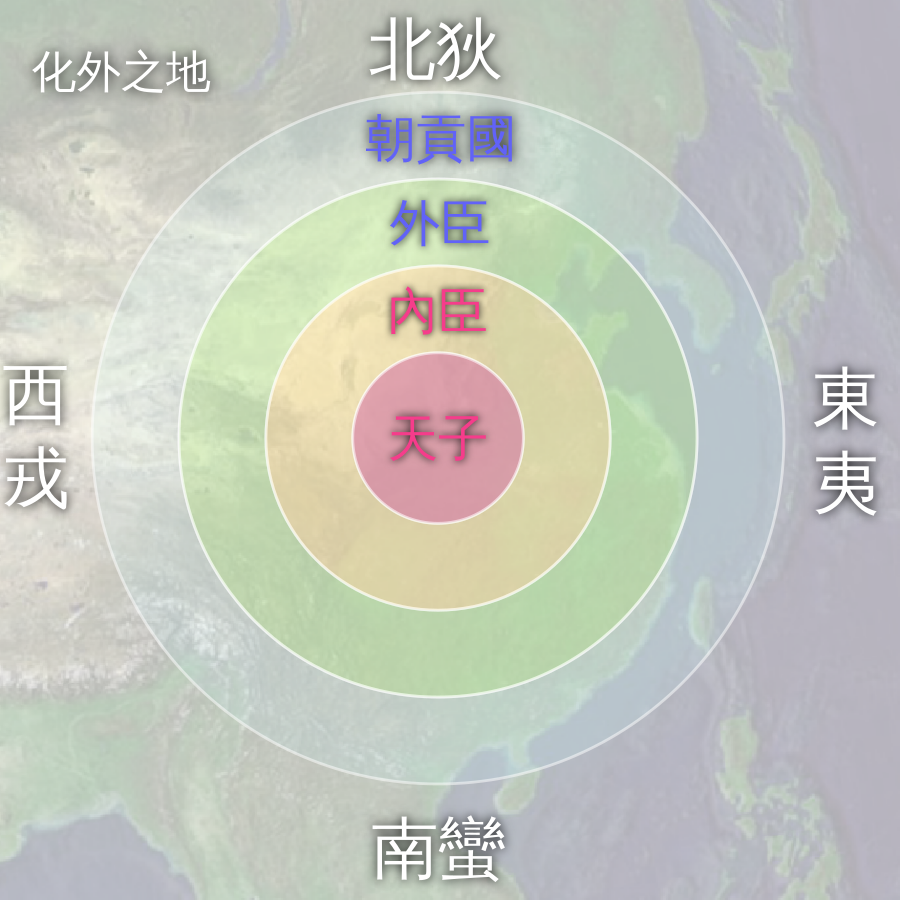

# 概述

[胡人](https://zh.wikipedia.org/wiki/胡人)是中国古代对[中原王朝](https://zh.wikipedia.org/wiki/中原王朝)以外的一种称谓，是一种[华夷秩序](https://zh.wikipedia.org/wiki/华夷秩序)。

<figure>
  
  <figcaption style="font-size: 16px; color: gray">天下秩序图</figcaption>
</figure>
# 相关列表

> [古代的诸种胡人](https://zh.wikipedia.org/wiki/胡人#古代的諸種胡人)
>
> [胡人在华所建诸政权](https://zh.wikipedia.org/wiki/胡人#在華所建諸政權)

# 东北古老三大部族

- [东胡](https://zh.wikipedia.org/wiki/东胡)
- [<ruby>濊貊<rp>(</rp><rt>huì mò</rt><rp>)</rp></ruby>](https://zh.wikipedia.org/wiki/濊貊)
- [肃慎](https://zh.wikipedia.org/wiki/肃慎)

# 征服与渗透

根据少数民族是否被彻底汉化，将少数民族政权分为：

- [征服王朝](https://zh.wikipedia.org/wiki/征服王朝)：吸收汉文化的同时亦刻意保持自身文化
- [渗透王朝](https://zh.wikipedia.org/wiki/渗透王朝)：吸收汉文化并彻底被汉化

# 兴起顺序

- 商周至秦汉：[**东胡**](https://zh.wikipedia.org/wiki/东胡)
  - 早期与匈奴并立於中国北方的游牧民族联盟，活动於燕山以北。
  - 前206年被匈奴冒顿单于击溃，分裂为乌桓和鲜卑。

- 秦汉时期：[**匈奴**](https://zh.wikipedia.org/wiki/匈奴)
  - 中国北方第一个强大的游牧帝国，秦末汉初由冒顿单于统一蒙古高原，建立强大政权。
  - 与汉朝长期和战交替，48年分裂为南、北匈奴。南匈奴内附汉化，北匈奴在东汉的持续打击下西迁。

- 东汉至南北朝：[**鲜卑**](https://zh.wikipedia.org/wiki/鲜卑)
  - 东胡的一支
  - 北匈奴西迁后，鲜卑趁机占据蒙古草原。
  - 魏晋南北朝时期，鲜卑各部南下建立多个政权，其中**拓跋鲜卑**建立的**北魏**（386年）统一北方。

- 南北朝：[**柔然**](https://zh.wikipedia.org/wiki/柔然)
  - 源自鲜卑
  - 继鲜卑之后在蒙古高原崛起的游牧汗国，与北魏进行了长期的战争，最终在6世纪中叶被突厥人所灭。

- 南北朝至隋唐：[**突厥**](https://zh.wikipedia.org/wiki/古突厥)
  - 原为柔然锻奴，552年崛起并灭柔然，建立突厥汗国，疆域辽阔。
  - 583年隋文帝用离间计使其分裂为**东突厥**和**西突厥**。
  - 唐朝时，突厥最终为唐所联合的回纥等力量灭

- 隋唐时期：[**回纥**](https://zh.wikipedia.org/wiki/回鹘)
  - 在唐朝联合下攻灭突厥，后壮大改称**回鹘**
  - 9世纪中期因内乱和黠戛斯攻击西迁，其中一支迁至西域，发展成为今天的**维吾尔族**

- 唐末至宋：[**契丹**](契丹.md)
  - 於辽河上游，唐末势力渐强
  - **耶律阿保机**於916年统一各部建立**辽朝**（初称契丹）
  - 与北宋订立澶渊之盟，后为金所灭
  - 部分契丹人在耶律大石率领下西迁建立**西辽**

- 宋：[**党项**](党项.md)
  - 西北（宁夏、甘肃一带）
  - 北宋时李元昊于1038年称帝，建立**西夏**政权。
  - 1227年被蒙古所灭。

- 宋至明末：[**女真**](女真.md)
  - 先民为先秦的肃慎，隋唐时称靺鞨
  - 北宋时，**完颜阿骨打**统一女真各部，於1115年建立**金朝**，灭辽和北宋。金朝被蒙古人所灭
  - 明末，女真再度兴起，**努尔哈赤**统一女真各部，建立**后金**，其子皇太极改族名为**满洲**，后发展为**清朝**

- 元明时期：[**蒙古**](蒙古族.md)
  - 源於东胡系统的室韦
  - **铁木真**（成吉思汗）於1206年统一各部，建立**大蒙古国**。
  - 其后发动大规模西征，建立横跨欧亚的帝国。其孙忽必烈建立**元朝**（1271年）并统一全国
  - 元亡后，蒙古退居漠北。

**有待重新确认对应年份，另外再加上世界范围的强权**

| 朝代      | 开始时间 | 时间戳       | 结束时间 | 持续时间 |
| --------- | -------- | ------------ | -------- | -------- |
| 东胡      | -770     | -86466009600 | -206     | 564      |
| 匈奴      | -770     | -86466009600 | 89       | 859      |
| 鲜卑      | 250      | -54277948800 | 589      | 339      |
| 柔然      | 480      | -47019830400 | 650      | 170      |
| 突厥      | 550      | -44810841600 | 850      | 300      |
| 回纥      | 552      | -44747769600 | 840      | 288      |
| 契丹      | 744      | -38688883200 | 1125     | 381      |
| 党项      | 916      | -33261062400 | 1227     | 311      |
| 女真      | 1115     | -26981251200 | 1234     | 119      |
| 蒙古      | 1150     | -25876713600 | 1350     | 200      |
| 女真/满族 | 1616     | -11171174400 | 1912     | 296      |
| 春秋战国  | -770     | -86466009600 | -221     | 549      |
| 秦汉      | -221     | -69141254400 | 220      | 441      |
| 三国两晋  | 220      | -55224720000 | 420      | 200      |
| 南北朝    | 420      | -48913286400 | 589      | 169      |
| 隋唐      | 581      | -43832534400 | 907      | 326      |
| 五代十国  | 907      | -33545059200 | 979      | 72       |
| 两宋      | 960      | -31872528000 | 1279     | 319      |
| 元朝      | 1206     | -24109488000 | 1368     | 162      |
| 明朝      | 1368     | -18997286400 | 1644     | 276      |
| 后金及清  | 1616     | -11171174400 | 1912     | 296      |

```mermaid
gantt
    title 胡人兴起顺序
    dateFormat X
    axisFormat %-Y
        section 南方中原
        春秋战国 :-86466009600, 549y
        秦汉 :-69141254400, 441y
        三国两晋 :-55224720000, 200y
        南北朝 :-48913286400, 169y
        隋唐 :-43832534400, 326y
        五代十国 :-33545059200, 72y
        两宋 :-31872528000, 319y
        元朝 :-24109488000, 162y
        明朝 :-18997286400, 276y
        后金及清 :-11171174400, 268y

        section 北方胡人
        东胡 :-86466009600, 564y
        匈奴 :-86466009600, 859y
        鲜卑 :-54277948800, 339y
        柔然 :-47019830400, 170y
        突厥 :-44810841600, 300y
        回纥 :-44747769600, 288y
        契丹 :-38688883200, 381y
        党项 :-33261062400, 311y
        女真 :-26981251200, 119y
        蒙古 :-25876713600, 200y
        满族 :-11171174400, 296y
```

