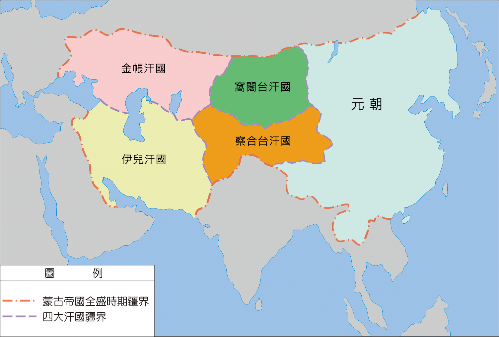

# 蒙古四大汗国

[**蒙古四大汗国**](https://zh.wikipedia.org/wiki/蒙古四大汗国)，简称**四大汗国**，是对从从[蒙古帝国](https://zh.wikipedia.org/wiki/蒙古帝国)分裂出的[钦察汗国](https://zh.wikipedia.org/wiki/欽察汗國)、[察合台汗国](https://zh.wikipedia.org/wiki/察合台汗國)、[窝阔台汗国](https://zh.wikipedia.org/wiki/窩闊台汗國)、[伊儿汗国](https://zh.wikipedia.org/wiki/伊兒汗國)这四个蒙古汗国的合称。

<figure>
  
  <figcaption style="font-size: 16px; color: gray">元朝和四大汗国并立时期</figcaption>
</figure>

# 历史

- 1225年，成吉思汗对诸子大行分封。

# 时间线

不同作者选取了不同的"建国标准"：有的是**分封元年**，有的是**兀鲁思（封地）实质统治元年**，有的是**建都自立元年**，有的是**独立/册封元年**。

| 汗国                                                       | 分封/起源                | 实质建国             | 建都/独立                   | 灭亡      | 备注                                   |
| ---------------------------------------------------------- | ------------------------ | -------------------- | --------------------------- | --------- | -------------------------------------- |
| [**钦察汗国**](https://zh.wikipedia.org/wiki/欽察汗國)     | 1225（成吉思汗分封术赤） | 1240（拔都西征结束） | **1242（拔都建萨莱）**      | 1502      | 拔都实际开国                           |
| [**察合台汗国**](https://zh.wikipedia.org/wiki/察合台汗國) | **1224（察合台获封）**   | 1224                 | 13 世纪中期（蒙哥死后独立） | 1570/1700 | 建国最早，独立较晚                     |
| [**窝阔台汗国**](https://zh.wikipedia.org/wiki/窩闊台汗國) | 1224（窝阔台获封）       | **1251（海都自立）** | 1251                        | 1309      | 唯一由"重自立"而非"分封自然长成"的汗国 |
| [**伊儿汗国**](https://zh.wikipedia.org/wiki/伊兒汗國)     | 1252（旭烈兀西征）       | **1256（灭木剌夷）** | 1264（忽必烈册封）          | 1355      | 拖雷系，建国最晚                       |