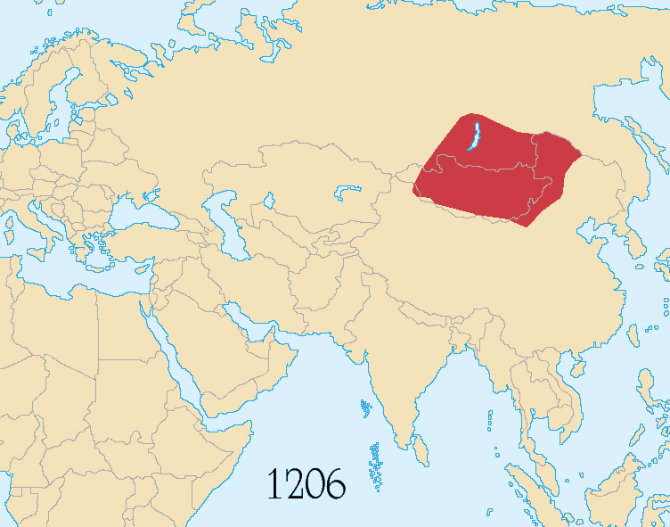

# 概述

[**蒙古帝国**](https://zh.wikipedia.org/wiki/蒙古帝国)（[1206年](https://zh.wikipedia.org/wiki/铁木真 "铁木真称汗")—[1368年9月14日](https://zh.wikipedia.org/wiki/徐达北伐 "徐达北伐，元朝灭亡")），是[**中国历史支线**](中国朝代.md#中国历史支线)之一、[元朝](元朝.md)支线之一，国号**大蒙古国**，国君姓氏[**孛儿只斤**](孛儿只斤氏.md)，是[蒙古人](<(蒙古族.md)>)建立的国家，强盛时是一个横跨欧亚两洲的[全球帝国](https://zh.wikipedia.org/wiki/全球帝国)，也是历史上[邻接版图最辽阔的国家](https://zh.wikipedia.org/wiki/最大帝國列表)。

<figure>
  
  <figcaption style="font-size: 16px; color: gray">蒙古帝国疆域的演变（1206年－1294年）</figcaption>
</figure>
# 历史

之前历史详见[蒙古族](蒙古族.md)。

## 建立与扩张

- [南宋](https://zh.wikipedia.org/wiki/南宋)[开禧](https://zh.wikipedia.org/wiki/开禧)二年（1206年），蒙古人[铁木真](https://zh.wikipedia.org/wiki/铁木真)在[斡难河](https://zh.wikipedia.org/wiki/鄂嫩河)称**汗**（即**成吉思汗**），建立**大蒙古国**。
- [蒙古西征](https://zh.wikipedia.org/wiki/蒙古征战)（1219年—1260年）

## 分裂

- 1260年，[忽必烈](忽必烈.md)与[阿里不哥](https://zh.wikipedia.org/wiki/阿里不哥)爆发[汗位之争](https://zh.wikipedia.org/wiki/拖雷家族内)，标志着帝国**政治分裂**的开始，继而分裂出[四大汗国](https://zh.wikipedia.org/wiki/蒙古四大汗国)。
- 1264年，忽必烈击败阿里不哥，但[四大汗国](https://zh.wikipedia.org/wiki/蒙古四大汗国)已逐渐独立。

## 元朝

- [至元](<https://zh.wikipedia.org/wiki/至元_(元世祖)>)八年十一月十五日（1271年12月18日），[忽必烈](忽必烈.md)颁步《[建国号诏](https://zh.wikisource.org/wiki/建國號詔)》，将国号由**大蒙古国**改为**大元**，[元朝](元朝.md)开始。
- 1368年9月14日，[明朝](明朝.md)[徐达](https://zh.wikipedia.org/wiki/徐達)率军攻陷大都（北京），[元顺帝](https://zh.wikipedia.org/wiki/元順帝)撤退至[上都](https://zh.wikipedia.org/wiki/元上都)，[元朝](元朝.md)**在中原的统治结束**，[蒙古帝国](蒙古帝国.md)瓦解，[北元](北元.md)开始。

## 明代蒙古

- 元廷退至[上都](https://zh.wikipedia.org/wiki/元上都)以后，继续沿用**大元**国号，[北元](北元.md)**开始**。
- 1388年11月1日，[也速迭儿](https://zh.wikipedia.org/wiki/卓里克圖)杀害[天元帝](https://zh.wikipedia.org/wiki/天元帝)，[北元](北元.md)灭亡，[大元](元朝.md)国号废除，恢复**大蒙古国**国号，即[**鞑靼**](https://zh.wikipedia.org/wiki/鞑靼_(蒙古))。
- 此后，蒙古草原进入[**鞑靼**](https://zh.wikipedia.org/wiki/鞑靼_(蒙古))（东蒙古，蒙古本部，黄金家族系）与[**瓦剌**](https://zh.wikipedia.org/wiki/瓦剌)（西蒙古，卫拉特系）并立争雄时期。

## 清朝以后

- 1635年6月12日，[额哲](https://zh.wikipedia.org/wiki/额哲)投降[后金](后金.md)，漠南蒙古诸部奉[皇太极](皇太极.md)为蒙古可汗，[黄金家族](https://zh.wikipedia.org/wiki/黄金家族)对漠南蒙古的法统终结，大蒙古国正式灭亡。
- 1785年，[布哈拉汗国](https://zh.wikipedia.org/wiki/布哈拉汗国)的阿布·加齐可汗退位，[黄金家族](https://zh.wikipedia.org/wiki/黄金家族)对中亚的法统终结。
- 1847年，[哈萨克汗国](https://zh.wikipedia.org/wiki/哈萨克汗国)的[克涅萨热](https://zh.wikipedia.org/wiki/克涅萨热·卡西莫夫)可汗阵亡，[黄金家族](https://zh.wikipedia.org/wiki/黄金家族)对哈萨克草原法统终结，这也是[黄金家族](https://zh.wikipedia.org/wiki/黄金家族)在全世界范围内最后一个法统的终结。

# 君主

> [蒙古可汗世系图](https://zh.wikipedia.org/wiki/蒙古可汗世系图)
>
> [蒙古汗国君主列表](https://zh.wikipedia.org/wiki/蒙古汗国君主列表)
