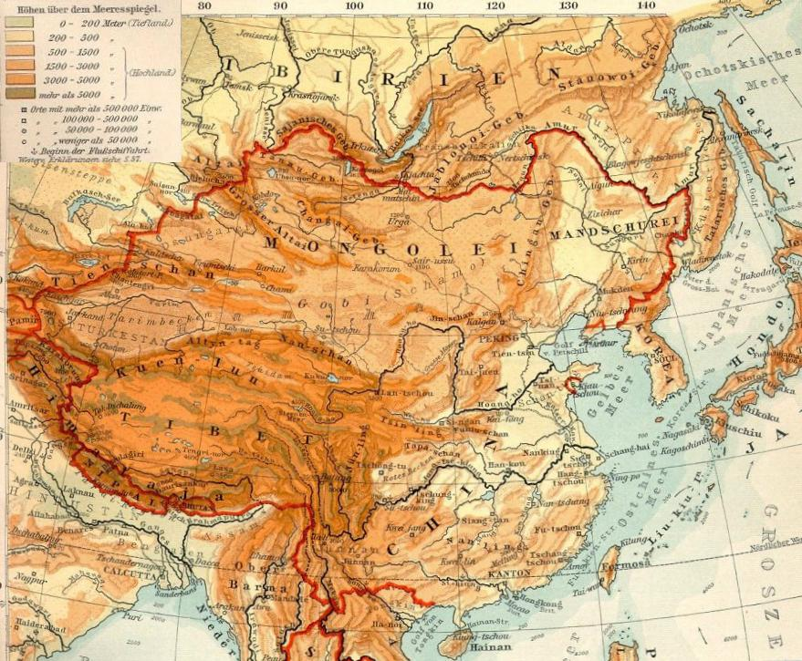

# 蒙古高原

[**蒙古高原**](https://zh.wikipedia.org/wiki/蒙古高原)泛指亚洲东北部高原地区，亦即[东亚](https://zh.wikipedia.org/wiki/东亚)与[北亚](https://zh.wikipedia.org/wiki/北亚)之间的内陆高原。蒙古高原东起[大兴安岭](https://zh.wikipedia.org/wiki/大兴安岭)，西达[阿尔泰山脉](https://zh.wikipedia.org/wiki/阿尔泰山脉)，北连[萨彦岭](https://zh.wikipedia.org/wiki/萨彦岭)、[肯特山](https://zh.wikipedia.org/wiki/肯特山)、[雅布洛诺夫山脉](https://zh.wikipedia.org/wiki/雅布洛诺夫山脉)，面积260万平方公里，南界[戈壁沙漠](https://zh.wikipedia.org/wiki/戈壁)和[阴山山脉](https://zh.wikipedia.org/wiki/阴山山脉)一线，包括[蒙古国](https://zh.wikipedia.org/wiki/蒙古国)全境，[俄罗斯](https://zh.wikipedia.org/wiki/俄罗斯)南部的[图瓦](https://zh.wikipedia.org/wiki/图瓦共和国)、[布里亚特共和国](https://zh.wikipedia.org/wiki/布里亚特共和国)与[外贝加尔边疆区](https://zh.wikipedia.org/wiki/外貝加爾邊疆區)，[中国](中华人民共和国.md)[内蒙古东四盟](https://zh.wikipedia.org/wiki/东四盟)部分地区与[新疆维吾尔自治区](https://zh.wikipedia.org/wiki/新疆维吾尔自治区)北部部分地区。

有史记载以来先后成为多个不同的游牧民族活动区域，例如[匈奴](匈奴.md)、[乌桓](乌桓.md)、[鲜卑](鲜卑.md)、[柔然](柔然.md)、[铁勒](https://zh.wikipedia.org/wiki/铁勒)、[突厥](突厥.md)、[回鹘](回鹘.md)、[契丹](契丹.md)等。欧洲[地理大发现](https://zh.wikipedia.org/wiki/地理大发现)时期这一带主要为[蒙古族](蒙古族.md)的活动区域，故被称为“**蒙古高原**”。

<figure>
  
  <figcaption style="font-size: 16px; color: gray">1903年的东亚地形图，北部为蒙古高原。</figcaption>
</figure>

# 历史

> [蒙古历史](https://zh.wikipedia.org/wiki/蒙古历史)

# 君主

> [蒙古高原君主列表](https://zh.wikipedia.org/wiki/蒙古高原君主列表)

# 政权

<table style="width: 50%; text-align: center; margin: 0 auto">
  <tbody>
    <tr>
      <th colspan="6" style="background: #efeeee">
        

          <a href="https://zh.wikipedia.org/wiki/蒙古高原" title="蒙古高原"
            >蒙古高原</a
          >历史系列条目
        

      </th>
    </tr>
    <tr>
      <td colspan="4" style="background: #ffece1; padding: 3px">
        <a href="https://zh.wikipedia.org/wiki/匈奴" title="匈奴">匈奴</a>
      </td>
      <td rowspan="1" colspan="2" style="background: #e0ffff; padding: 3px">
        <a href="https://zh.wikipedia.org/wiki/东胡" title="东胡">东胡</a>
      </td>
    </tr>
    <tr>
      <td colspan="2" style="background: #ffece1; padding: 3px">
        <a href="https://zh.wikipedia.org/wiki/南匈奴" title="南匈奴"
          >南匈奴</a
        >
      </td>
      <td colspan="2" style="background: #ffece1; padding: 3px">
        <a href="https://zh.wikipedia.org/wiki/北匈奴" title="北匈奴"
          >北匈奴</a
        >
      </td>
      <td colspan="2" style="background: #e0ffff; padding: 3px">
        <a href="https://zh.wikipedia.org/wiki/鲜卑" title="鲜卑">鲜卑</a>
      </td>
    </tr>
    <tr>
      <td colspan="4" style="background: #e0ffff; padding: 3px">
        <a href="https://zh.wikipedia.org/wiki/鲜卑" title="鲜卑">鲜卑</a>
      </td>
      <td colspan="2" style="background: #d7e3f8; padding: 3px">
        <a href="https://zh.wikipedia.org/wiki/丁零" title="丁零">丁零</a>
      </td>
    </tr>
    <tr>
      <td colspan="4" style="background: #e0ffff; padding: 3px">
        <a href="https://zh.wikipedia.org/wiki/柔然" title="柔然">柔然</a>
      </td>
      <td rowspan="1" colspan="2" style="background: #d7e3f8; padding: 3px">
        <a href="https://zh.wikipedia.org/wiki/敕勒" title="敕勒">高车</a>
      </td>
    </tr>
    <tr>
      <td colspan="4" style="background: #ffe1ff; padding: 3px">
        <a href="https://zh.wikipedia.org/wiki/突厥汗国" title="突厥汗国"
          >突厥汗国</a
        >
      </td>
      <td style="background: #d7e3f8; padding: 3px">
        <a href="https://zh.wikipedia.org/wiki/铁勒" title="铁勒">铁勒</a>
      </td>
    </tr>
    <tr>
      <td colspan="6" style="background: #ffe1ff; padding: 3px">
        <a href="https://zh.wikipedia.org/wiki/東突厥" title="东突厥"
          >东突厥</a
        >
      </td>
    </tr>
    <tr>
      <td colspan="6" style="background: #d7e3f8; padding: 3px">
        <a href="https://zh.wikipedia.org/wiki/薛延陀" title="薛延陀"
          >薛延陀</a
        >
      </td>
    </tr>
    <tr>
      <td colspan="6" style="background: #f5f5dc; padding: 3px">
        <a href="https://zh.wikipedia.org/wiki/唐朝" title="唐朝">唐朝</a
        >（<a
          href="https://zh.wikipedia.org/wiki/单于都护府"
          title="单于都护府"
          >单于都护府</a
        >·<a
          href="https://zh.wikipedia.org/wiki/安北都护府"
          title="安北都护府"
          >安北都护府</a
        >）
      </td>
    </tr>
    <tr>
      <td colspan="6" style="background: #ffe1ff; padding: 3px">
        <a
          href="https://zh.wikipedia.org/wiki/后突厥汗国"
          title="后突厥汗国"
          >后突厥汗国</a
        >
      </td>
    </tr>
    <tr>
      <td colspan="6" style="background: #d7e3f8; padding: 3px">
        <a href="https://zh.wikipedia.org/wiki/回鹘汗国" title="回鹘汗国"
          >回鹘汗国</a
        >
      </td>
    </tr>
    <tr>
      <td colspan="2" style="background: #e0ffff; padding: 3px">
        <a href="https://zh.wikipedia.org/wiki/契丹人" title="契丹人"
          >契丹</a
        >
      </td>
      <td colspan="2" style="background: #ffe1ff; padding: 3px">
        <a href="https://zh.wikipedia.org/wiki/阻卜" title="阻卜">阻卜</a>
      </td>
      <td colspan="2" style="background: #ffeec1; padding: 3px">
        <a
          href="https://zh.wikipedia.org/wiki/叶尼塞吉尔吉斯人"
          title="叶尼塞吉尔吉斯人"
          >黠戛斯</a
        >
      </td>
    </tr>
    <tr>
      <td colspan="2" style="background: #e0ffff; padding: 3px">
        <a href="https://zh.wikipedia.org/wiki/辽朝" title="辽朝">辽朝</a>
      </td>
      <td rowspan="2" colspan="2" style="background: #e1ffe1; padding: 3px">
        <a href="https://zh.wikipedia.org/wiki/克烈" title="克烈">克烈</a>
      </td>
      <td rowspan="2" colspan="2" style="background: #d7e3f8; padding: 3px">
        <a href="https://zh.wikipedia.org/wiki/乃蛮" title="乃蛮">乃蛮</a>
      </td>
    </tr>
    <tr>
      <td colspan="2" style="background: #f5deb3; padding: 3px">
        <a href="https://zh.wikipedia.org/wiki/蒙兀国" title="蒙兀国"
          >蒙兀</a
        >
      </td>
    </tr>
    <tr>
      <td colspan="6" style="background: #ffeec1; padding: 3px">
        <a href="https://zh.wikipedia.org/wiki/蒙古帝国" title="蒙古帝国"
          >蒙古帝国</a
        >（诸<a href="https://zh.wikipedia.org/wiki/汗國" title="汗国"
          >汗国</a
        >）
      </td>
    </tr>
    <tr>
      <td colspan="6" style="background: #ffeec1; padding: 3px">
        <a href="元朝.md" title="元朝">元朝</a
        >（<a
          href="https://zh.wikipedia.org/wiki/岭北等处行中书省"
          title="岭北等处行中书省"
          >岭北等处行中书省</a
        >）
      </td>
    </tr>
    <tr>
      <td rowspan="1" colspan="6" style="background: #ffeec1; padding: 3px">
        <a href="https://zh.wikipedia.org/wiki/明朝" title="明朝">明朝</a
        >（<a href="https://zh.wikipedia.org/wiki/北元" title="北元">北元</a
        >与<a href="https://zh.wikipedia.org/wiki/明代蒙古" title="明代蒙古"
          >明代蒙古</a
        >）
      </td>
    </tr>
    <tr>
      <td rowspan="1" colspan="4" style="background: #ffeec1; padding: 3px">
        <a
          href="https://zh.wikipedia.org/wiki/鞑靼_(蒙古)"
          title="鞑靼 (蒙古)"
          >鞑靼</a
        >
      </td>
      <td rowspan="1" colspan="2" style="background: #ffece1; padding: 3px">
        <a href="https://zh.wikipedia.org/wiki/瓦剌" title="瓦剌">瓦剌</a
        ><small>（西蒙古）</small>
      </td>
    </tr>
    <tr>
      <td colspan="2" style="background: #f5deb3; padding: 3px">
        <a
          href="https://zh.wikipedia.org/wiki/喀尔喀蒙古族"
          title="喀尔喀蒙古族"
          >喀尔喀<small>（漠北蒙古）</small></a
        >
      </td>
      <td colspan="2" style="background: #f5deb3; padding: 3px">
        <a href="https://zh.wikipedia.org/wiki/漠南蒙古" title="漠南蒙古"
          >漠南蒙古</a
        >
      </td>
      <td rowspan="1" colspan="2" style="background: #ffece1; padding: 3px">
        <small
          >（<a
            href="https://zh.wikipedia.org/wiki/四卫拉特"
            title="四卫拉特"
            >四卫拉特</a
          >/漠西蒙古）</small
        >
      </td>
    </tr>
    <tr>
      <td colspan="6" style="background: #f7fabe; padding: 3px">
        <a href="https://zh.wikipedia.org/wiki/清朝" title="清朝">清朝</a
        >（<a href="https://zh.wikipedia.org/wiki/清代蒙古" title="清代蒙古"
          >清代蒙古</a
        >）·<a
          href="https://zh.wikipedia.org/wiki/准噶尔汗国"
          title="准噶尔汗国"
          >准噶尔汗国</a
        >
      </td>
    </tr>
    <tr>
      <td colspan="6" style="background: #f7fabe; padding: 3px">
        <a href="https://zh.wikipedia.org/wiki/內屬蒙古" title="内属蒙古"
          >内属蒙古</a
        >·<a href="https://zh.wikipedia.org/wiki/外藩蒙古" title="外藩蒙古"
          >外藩蒙古</a
        >（<a
          href="https://zh.wikipedia.org/wiki/內札薩克蒙古"
          title="内札萨克蒙古"
          >内札萨克</a
        >·<a
          href="https://zh.wikipedia.org/wiki/外札薩克蒙古"
          title="外札萨克蒙古"
          >外札萨克</a
        >）
      </td>
    </tr>
    <tr>
      <td rowspan="3" colspan="2" style="background: #ffffe1; padding: 3px">
        <a
          href="https://zh.wikipedia.org/wiki/中華民國盟部旗列表"
          title="中华民国盟部旗列表"
          >中华民国境内盟旗</a
        > <small
          >（<a
            href="https://zh.wikipedia.org/wiki/塞北四省"
            class="mw-redirect"
            title="塞北四省"
            >塞北四省</a
          >）</small
        >
      </td>
      <td colspan="4" style="background: #ffeec1; padding: 3px">
        <a
          href="https://zh.wikipedia.org/wiki/博克多汗国"
          title="博克多汗国"
          >博克多蒙古国</a
        >
      </td>
    </tr>
    <tr>
      <td colspan="4" style="background: #ffffe1; padding: 3px">
        <a
          href="https://zh.wikipedia.org/wiki/外蒙古撤销自治"
          title="外蒙古撤销自治"
          >外蒙古</a
        ><small
          >（<a
            href="https://zh.wikipedia.org/wiki/蒙古地方"
            title="蒙古地方"
            >地方</a
          >）</small
        >
      </td>
    </tr>
    <tr>
      <td rowspan="2" colspan="4" style="background: #f5deb3; padding: 3px">
        <a
          href="https://zh.wikipedia.org/wiki/蒙古人民共和国"
          title="蒙古人民共和国"
          >蒙古人民共和国</a
        >
      </td>
    </tr>
    <tr>
      <td rowspan="2" colspan="2" style="background: #f5f5dc; padding: 3px">
        <a
          href="https://zh.wikipedia.org/wiki/中国蒙古族"
          title="中国蒙古族"
          >中国蒙古族</a
        > <small
          >（<a
            href="https://zh.wikipedia.org/wiki/内蒙古自治区"
            title="内蒙古自治区"
            >内蒙古自治区</a
          >）</small
        >
      </td>
    </tr>
    <tr>
      <td colspan="4" style="background: #ffeec1; padding: 3px">
        <a href="https://zh.wikipedia.org/wiki/蒙古国" title="蒙古国"
          >蒙古国</a
        >
      </td>
    </tr>
  </tbody>
</table>
# 名称

[戈壁沙漠](戈壁沙漠.md)：[漠南](https://zh.wikipedia.org/wiki/漠南)、[漠北](https://zh.wikipedia.org/wiki/漠北)、[漠西](https://zh.wikipedia.org/wiki/漠西)以此分界。
