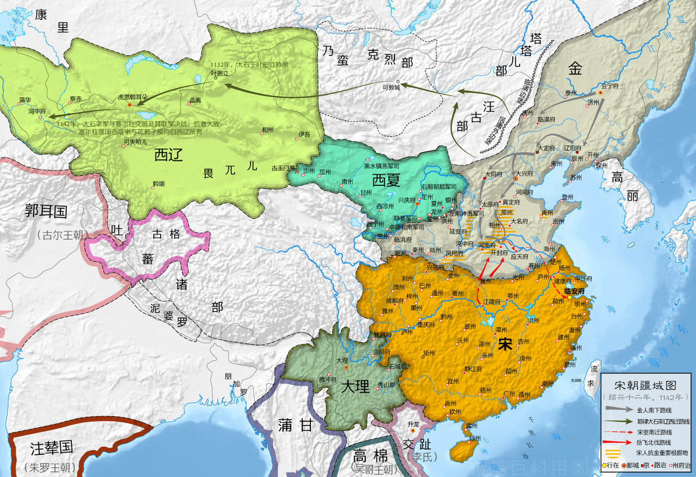

# 西辽

## 概述

[**西辽**](https://zh.wikipedia.org/wiki/西辽)（1124年—[1218年](https://zh.wikipedia.org/wiki/蒙古攻西辽之战 "蒙古攻西辽之战")），是**中国历史支线**之一、[辽朝](辽朝.md)支线之一，国号**大辽**，又称**后辽**、**喀喇契丹**、**哈剌契丹**，是[辽朝](辽朝.md)宗室重臣[耶律大石](https://zh.wikipedia.org/wiki/耶律大石)在辽朝灭亡之际重新建立的以“**大辽**”为国号的王朝。因位于先前[耶律阿保机](https://zh.wikipedia.org/wiki/耶律阿保机)所建的[辽朝](辽朝.md)之西，该政权被史称为“**西辽**”。

## 历史

- 1124年，[辽朝](辽朝.md)宗室重臣[耶律大石](https://zh.wikipedia.org/wiki/耶律大石)在辽朝西北边陲镇州可敦城（今蒙古国布尔干省青托罗盖古回鹘城）称王，改元延庆。耶律大石是[辽朝](辽朝.md)开国君主[耶律阿保机](https://zh.wikipedia.org/wiki/耶律阿保机)的八世孙。

- 1132年，耶律大石在叶密立（今新疆额敏县）称帝，国号为“**辽**”，史称[西辽](https://zh.wikipedia.org/wiki/西辽)。

- 1141年，西辽在[卡特万之战](https://zh.wikipedia.org/wiki/卡特万之战)中击败[塞尔柱帝国](https://zh.wikipedia.org/wiki/塞尔柱帝国)联军，征服[河中地区](https://zh.wikipedia.org/wiki/河中地区)和[花剌子模](https://zh.wikipedia.org/wiki/花剌子模王朝)，从此成为中亚霸主。

    <figure>
      
      <figcaption style="font-size: 16px; color: gray">
        
浅绿部分为西辽鼎盛时期的版图

        
右侧虚线内为耶律大石早期的势力范围

      </figcaption>
    </figure>

- 1211年，[突厥](https://zh.wikipedia.org/wiki/古突厥)[乃蛮部](https://zh.wikipedia.org/wiki/乃蛮)贵族[屈出律](https://zh.wikipedia.org/wiki/屈出律)篡位称帝，但是仍以“辽”为国号。最终，[西辽](https://zh.wikipedia.org/wiki/西辽)于1218年被[成吉思汗](https://zh.wikipedia.org/wiki/成吉思汗)的[蒙古](蒙古帝国.md)军队所灭，国祚87年。

- 1218年，西辽被[蒙古帝国](蒙古帝国.md)在[攻辽战役](https://zh.wikipedia.org/wiki/蒙古攻西辽之战)中击败，西辽灭亡。
