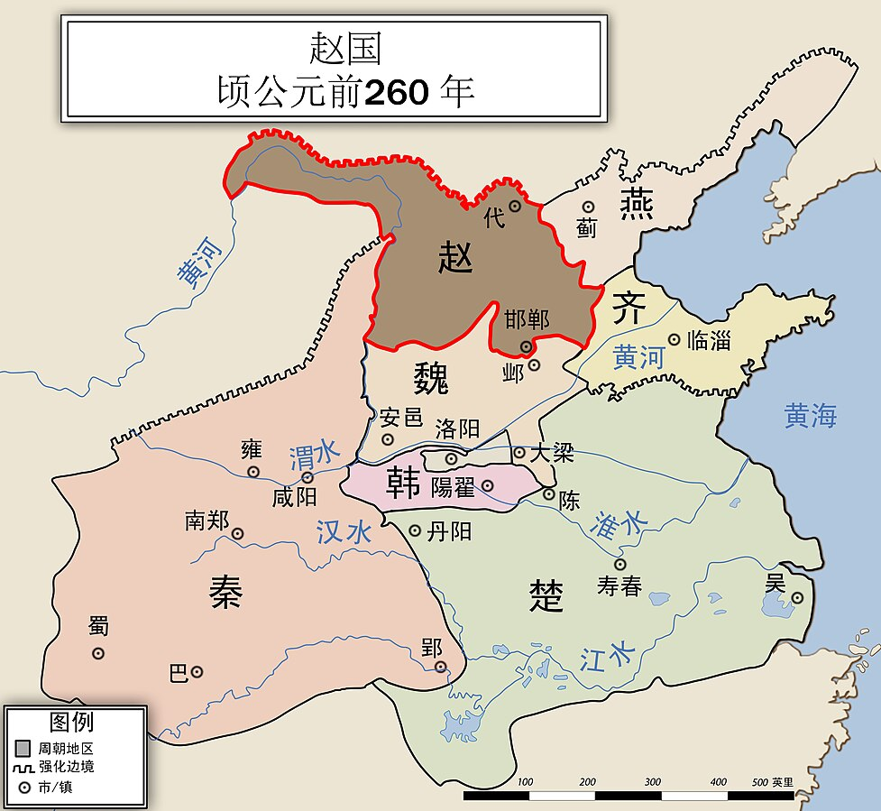

# 赵国

## 概述

[赵国](https://zh.wikipedia.org/wiki/赵国)（[前403年](https://zh.wikipedia.org/wiki/三家分晋 "三家分晋")—前228年），是[**中国历史支线**](中国-朝代.md#中国历史支线)之一，是[战国时期](战国时期.md)的[诸侯国](https://zh.wikipedia.org/wiki/诸侯国)，疆土主要有当今河北省南部、山西省中部和陕西省东北隅。

<figure>
  
  <figcaption style="font-size: 16px; color: gray">赵国（前260年）</figcaption>
</figure>

## 历史

- 前403年（[周威烈王](https://zh.wikipedia.org/wiki/周威烈王)23年，即[晋烈公](https://zh.wikipedia.org/wiki/晋烈公)13年），韩、赵、魏[三家分晋](https://zh.wikipedia.org/wiki/三家分晋)，[赵籍](https://zh.wikipedia.org/wiki/趙籍)被[周威烈王](https://zh.wikipedia.org/wiki/周威烈王)立为[诸侯](https://zh.wikipedia.org/wiki/诸侯)。
- 前307年，[赵武灵王](https://zh.wikipedia.org/wiki/赵武灵王)推行[胡服骑射](https://zh.wikipedia.org/wiki/胡服騎射)，先后征服楼烦、林胡、[中山](https://zh.wikipedia.org/wiki/中山国)，崛起为战国后期唯一能与[秦国](https://zh.wikipedia.org/wiki/秦国)抗衡的强国。
- 前262年—前260年，[长平之战](长平之战.md)，使得赵国从此一蹶不振。
- 前228年，秦国攻陷赵国首都邯郸，赵国灭亡。
- 前228年，赵国[大夫](<https://zh.wikipedia.org/wiki/大夫_(官名)>)在[代地](https://zh.wikipedia.org/wiki/代郡)拥立**公子嘉**逃到[代地](https://zh.wikipedia.org/wiki/代郡)称王，是为[代王嘉](https://zh.wikipedia.org/wiki/代王嘉)，建立[代国](<https://zh.wikipedia.org/wiki/代国_(战国)>)。前222年，秦将[王贲](https://zh.wikipedia.org/wiki/王賁)引兵攻代国，虏代王嘉，代国灭亡。
