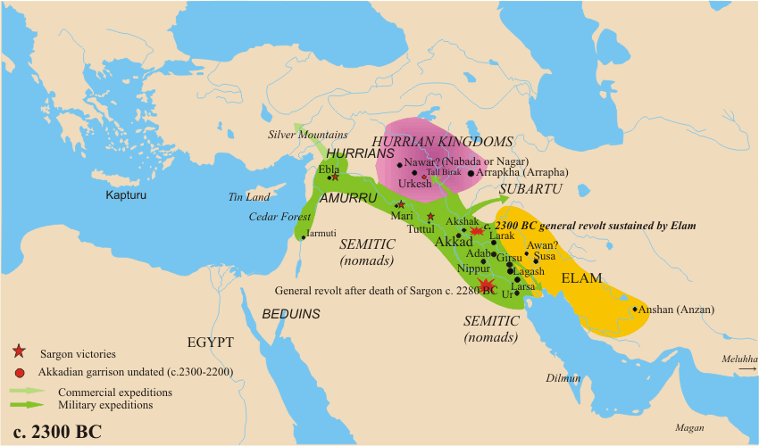

# 消歧义

[阿卡德](https://zh.wikipedia.org/wiki/阿卡德)可以指：

- [阿卡德人](阿卡德人.md)
- [阿卡德帝国](阿卡德帝国.md)
- [阿卡德 (城市)](https://zh.wikipedia.org/wiki/阿卡德_(城市))
- [阿卡德语](https://zh.wikipedia.org/wiki/阿卡德语)

# 概述

[**阿卡德帝国**](https://zh.wikipedia.org/wiki/阿卡德帝国)（前2334年—约前2192年），是[两河流域](两河流域.md)地区的第一个[帝国](https://zh.wikipedia.org/wiki/帝国)，被认为是史上最早的帝国，都城为[阿卡德](<https://zh.wikipedia.org/wiki/阿卡德_(城市)>)，缔造者为[阿卡德人](阿卡德人.md)，常用语言为[阿卡德语](https://zh.wikipedia.org/wiki/阿卡德语)、[苏美尔语](https://zh.wikipedia.org/wiki/苏美尔语)，继承者为[古提王朝](https://zh.wikipedia.org/wiki/古提王朝)，今属于[伊拉克](https://zh.wikipedia.org/wiki/伊拉克)、[伊朗](伊朗.md)、[叙利亚](https://zh.wikipedia.org/wiki/叙利亚)、[土耳其](土耳其.md)。

阿卡德帝国为[两河流域](两河流域.md)后来的诸多枭雄们树立了在该地区建立统一国家的先例。

<figure>
  
  <figcaption style="font-size: 16px; color: gray">阿卡德帝国的疆域（在图中以绿色标示）</figcaption>
</figure>

# 历史

- 前2334年[阿卡德城](<https://zh.wikipedia.org/wiki/阿卡德_(城市)>)的[阿卡德人](阿卡德人.md)[萨尔贡](https://zh.wikipedia.org/wiki/萨尔贡)击败温马王[卢加尔扎克西](https://zh.wikipedia.org/wiki/卢加尔扎克西)，建立了阿卡德王朝，并逐步将王权范围扩大到整个[两河流域](两河流域.md)。
- 约前2193年，末代君主[沙尔卡利沙瑞](https://zh.wikipedia.org/wiki/沙尔卡利沙瑞)去世，帝国崩溃，到处陷入无政府状态。

# 相关条目

- [阿卡德人](阿卡德人.md)
