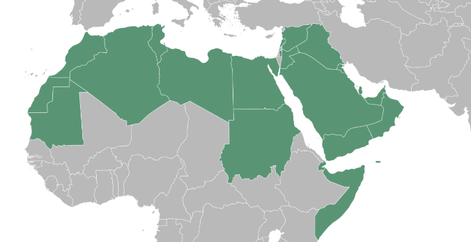

# 概述

[**阿拉伯世界**](https://zh.wikipedia.org/wiki/阿拉伯世界)，是指分布于[西亚](https://zh.wikipedia.org/wiki/西亚)和[北非](https://zh.wikipedia.org/wiki/北非)，以[阿拉伯语](https://zh.wikipedia.org/wiki/阿拉伯语)为主要语言，以[伊斯兰教](伊斯兰教.md)为主要信仰、以[阿拉伯人](阿拉伯人.md)为主要族群的国家和地区。

需要特别说明的是，信奉伊斯兰教的并不一定是阿拉伯国家：伊朗、土耳其、阿富汗都不是阿拉伯国家（其主体民族都不是[阿拉伯人](阿拉伯人.md)）。

<figure>
  
  <figcaption style="font-size: 16px; color: gray">阿拉伯国家分布图</figcaption>
</figure>

# 阿拉伯国家组织

- [**阿拉伯国家联盟**](https://zh.wikipedia.org/wiki/阿拉伯国家联盟)（League of Arab States），简称**阿盟**
- [**石油输出国组织**](https://zh.wikipedia.org/wiki/石油输出国组织)（Organization of Arab Petroleum Exporting Countries，缩写 **OAPEC**），简称**欧佩克**

# 阿拉伯国家与中国关系

阿拉伯国家同中国关系非常好，最明显的就是巴勒斯坦。2004年中国—阿拉伯国家合作论坛。

- 早在西汉时期，中国使节就曾到达阿拉伯国家。历史上，中阿通过“丝绸之路”的间接和直接贸易活跃，人员交往频繁。阿拉伯历法、数学、医药学等都对中国文化产生了重要影响。中国的造纸术、指南针和火药等发明经阿拉伯人传入欧洲。伊斯兰教于7世纪中叶传入中国。
- 阿拉伯帝国时期，751年，阿拉伯帝国呼罗珊军队在中亚怛罗斯战役中击败唐朝将领高仙芝率领的唐朝和葛逻禄联军，成功夺取了中亚费尔干纳盆地的控制权，与唐帝国隔葱岭（今称帕米尔高原）相对。阿拉伯帝国正是在这场战役中获得了造纸术。
- 阿拉伯帝国时期，唐天宝十四年（755年），安史之乱爆发。唐朝于757年向阿拉伯帝国求援，阿拉伯人随即派遣3千士兵帮助平定安史之乱。此后，吐蕃趁唐将西域兵力调回、防务空虚之际，联合进攻唐朝。安史之乱后，阿拉伯又在葱岭以西多次交兵，争取了西域的控制权。
- 1956年，埃及、叙利亚、也门等阿拉伯国家陆续与中国建立了外交关系，他们成为最早与中国建交的阿拉伯国家。1990年7月，我国与沙特建交，至此我国与所有阿拉伯国家均建立了外交关系。
- 1971年10月25日联合国大会第26届会议上，通过“两阿提案”，联合国通过了《联合国大会第2758号决议》。承认中华人民共和国政府的代表是中国在联合国组织的唯一合法代表，中华人民共和国是安全理事会五个常任理事国之一，并立即把蒋介石的代表从它在联合国组织及其所属一切机构中所非法占据的席位上驱逐出去。
- 2005年3月，以埃及为首的阿拉伯国家宣布，支持中国通过的《反分裂国家法》
- 2016年1月13日中国政府发布《中国对阿拉伯国家政策文件》，这是中国政府制订的首份对阿拉伯国家政策文件。
