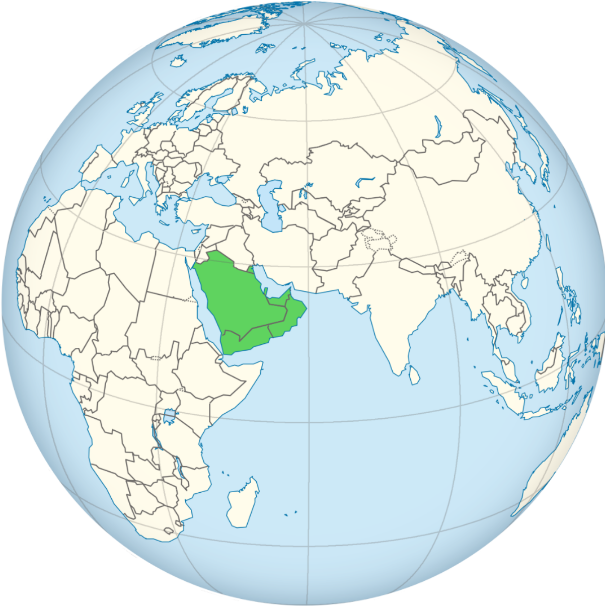

# 概述

[**阿拉伯半岛**](https://zh.wikipedia.org/wiki/阿拉伯半岛)（英语：The Arabian Peninsula），位于[西亚](https://zh.wikipedia.org/wiki/西亚)，面积约3,237,500平方公里，是世界上最大的[半岛](https://zh.wikipedia.org/wiki/半岛)，与印度半岛、[中南半岛](https://zh.wikipedia.org/wiki/中南半岛)并称**亚洲三大半岛**。

半岛沿[波斯湾](波斯湾.md)周围有大量[石油](https://zh.wikipedia.org/wiki/石油)储藏，自从20世纪陆续成功开采后，使临波斯湾的国家带来了巨大的财富。

阿拉伯半岛紧接亚非两洲，半岛两侧的红海和海湾，连通埃及和肥沃新月地带，形成一条重要的东西交通的天然走廊，地属交通要塞，战略位置十分重要。

阿拉伯半岛是[伊斯兰教](伊斯兰教.md)的诞生地，以半岛为中心的[阿拉伯帝国](阿拉伯帝国.md)曾横跨[欧亚非大陆](https://zh.wikipedia.org/wiki/欧亚非大陆)。

<figure>
  
  <figcaption style="font-size: 16px; color: gray">阿拉伯半岛位置</figcaption>
</figure>
