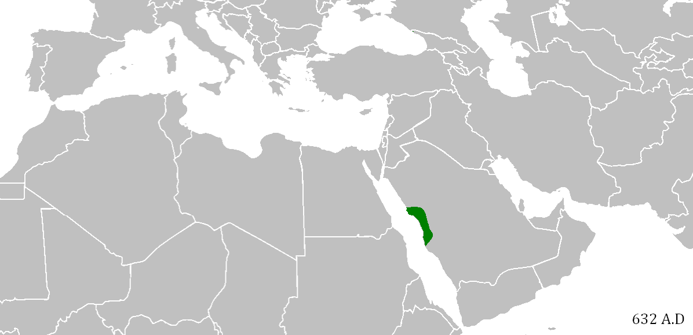

# 概述

[**阿拉伯帝国**](https://zh.wikipedia.org/wiki/阿拉伯帝国)（632年－1258年），是[阿拉伯半岛](阿拉伯半岛.md)上的[阿拉伯人](阿拉伯人.md)于[中世纪](https://zh.wikipedia.org/wiki/中世纪)创建的[哈里发国](https://zh.wikipedia.org/wiki/哈里發國)，主要包括[四大哈里发时期](https://zh.wikipedia.org/wiki/正统哈里发时期)、[倭马亚王朝](https://zh.wikipedia.org/wiki/倭马亚王朝)和[阿拔斯王朝](https://zh.wikipedia.org/wiki/阿拔斯王朝)三个时期，历经626年。

[唐朝](唐朝.md)以来的中国史书均称之为**大食**，而西欧则习惯将其称作[**萨拉森帝国**](https://zh.wikipedia.org/wiki/萨拉森人)。

阿拉伯极是继[波斯](https://zh.wikipedia.org/wiki/波斯)[阿契美尼德王朝](https://zh.wikipedia.org/wiki/阿契美尼德王朝)、[马其顿王国](https://zh.wikipedia.org/wiki/馬其頓王國)、[罗马帝国](https://zh.wikipedia.org/wiki/罗马帝国)之后又一个地跨[亚](亚洲.md)、[欧](https://zh.wikipedia.org/wiki/欧洲)、[非](https://zh.wikipedia.org/wiki/非洲)三洲的大帝国。

<figure>
  
  <figcaption style="font-size: 16px; color: gray">阿拉伯帝国扩张</figcaption>
</figure>

# 历史

## 伊斯兰教之前

- 阿拉伯人的民族来源可以上溯到远古的闪米特人部落，根据“亚伯拉罕诸教”经典记载，阿拉伯人是亚伯拉罕系以实玛利的后代。
- 前8世纪，阿拉伯半岛南部就出现了早期的阿拉伯国家。
- 从6世纪后半叶开始，由于埃及的混乱以及拜占廷和波斯之间的连年战争，使得原先的波斯湾－红海－尼罗河的商路无法通行，商人们改走更为安全的，通过阿拉伯半岛的陆路。地处商路中段，东到波斯湾，西至红海，北往叙利亚，南通也门的交通枢纽，商业城市麦加因此而变得繁荣起来。

## 帝国形成

- 7世纪，穆罕默德创立伊斯兰教，建立“乌玛”政权，领导穆斯林统一阿拉伯半岛。

## 四大哈里发时期（632年—661年）

- 632年，穆罕默德逝世后，由他的最亲近的门弟子艾布·伯克尔、欧麦尔、奥斯曼、阿里先后继承他的事业，称“哈里发”（意为安拉使者的继承人）。
- 最初的四大哈里发由穆斯林公社以协商、选举方式产生，历史上将这4位领袖统治时期称之为“四大哈里发时期”，又称“神权共和时期”或“正统哈里发时期”。
- 在此期间，历任哈里发利用北方拜占庭、波斯两大帝国长期争战的有利时机，以及伊斯兰教团结和力量，配合他们独有的沙漠作战经验，以“圣战”之名进行大规模的武力扩张。
- **第一任哈里发阿布·伯克尔（ Bakr，632年—634年）。**
  - 平息了也门南部、叶麻麦、哈达拉毛及巴林东部以伪先知图莱哈、穆赛利迈、赛贾赫（女）等为首所发动的武装叛乱，征服了变节者，重新统一了阿拉伯半岛，巩固了麦地那政权。
  - 阿拉伯人开始了最早的对外（东罗马帝国、波斯帝国萨珊王朝）战争，穆斯林则认为是防卫性进攻。

- **第二任哈里发欧麦尔（Umar，634年—644年），发动了阿拉伯历史上空前的大征服运动。**
  - 第二任哈里发的军队同时对拜占庭和波斯萨珊帝国展开了进攻。被称作“安拉之剑”的哈立德·伊本·韦立德，率领阿拉伯人于635年进入叙利亚，接连击败拜占庭，636年占领了叙利亚首府大马士革，两年后进军耶路撒冷。继而兵分两路，展开全面进攻。东线接连攻破波斯军队防线，占领了伊拉克和伊朗大部地区；西线继续连败拜占廷，西线继续连败拜占廷，顺势占领巴勒斯坦和埃及。
  - 采取凡归信伊斯兰教者免交人丁税的政策，吸引被征服地的居民多改奉伊斯兰教，使伊斯兰教发展成世界多民族信仰的宗教。
  - 初步确立了国家的行政管理制度、司法制度、军事制度、土地制度和年俸分配制度。
  - 制定了伊斯兰教历，以622年7月16日作为纪年元旦，以纪念穆罕默德由麦加迁徙麦地那这一重要历史事件。

- **第三任哈里发奥斯曼（Osman，644年—656年），继续进行扩张战争，内部产生分裂。**
  - 东线阿拉伯军队乘胜追击战败的波斯萨珊王朝，进军呼罗珊。651年，萨珊王朝灭亡，阿拉伯帝国夺得呼罗珊、亚美尼亚和阿塞拜疆等地；西线大军则继续攻入北非利比亚的昔兰尼加。
  - 为了进一步控制地中海，奥斯曼征集小亚细亚沿岸居民，建立了一支强大的海军。
  - 在艾布·伯克尔时所辑录的《古兰经》原抄本的基础上，经再次搜集、反复对照、核订和考证、编纂成奥斯曼定本《古兰经》，为伊斯兰教和阿拉伯语向世界的传播提供了经典依据。
  - 【**内部分裂**】正当对外扩张战争势如破竹时，帝国内部发生分裂。以阿里·伊本·艾比·塔里卜为首，哈希姆家族中部分亲阿里派的人对出身于倭马亚家族的奥斯曼出任哈里发的合法性提出质疑，并组建起什叶派，与普遍接受奥斯曼继位的逊尼派相对立。穆斯林首次内部分裂由此开端。

- **第四任哈里发阿里（Osman，574年—656年），发生内战。**
  - 656年，奥斯曼不幸遇刺，阿里继任哈里发。但此时以叙利亚总督穆阿维叶为首的倭马亚家族拒不承认阿里政权。双方数次火拼，未分胜负。不久，什叶派内部又出现分裂，部分对阿里表现不满的激进穆斯林组建了一个军事民主派——“哈瓦立及派”。
  - 661年，“哈瓦立及派”刺杀阿里，四大哈里发时期结束。

## 倭马亚王朝（661年—750年）

- 倭马亚王朝（又称“伍麦叶王朝”）时代是阿拉伯人军事扩张的第二个高峰期。
- 661年，倭马亚家族的叙利亚总督穆阿维叶即位哈里发，以大马士革为首都，建立了倭马亚王朝。由于国内的穆斯林穿著白衣，因此又称之为“白衣大食”。
- 在政治上；改哈里发的选举制为世袭制，使哈里发国家成为一个君主专制的封建国家。
- 在经济上，游牧的阿拉伯人开始迁徙新征服的地区，由游牧转入定居；从事农耕和经商。分封土地、统一币制、完善税收，封建制度进一步发展。
- 在文化上，王朝法定阿拉伯文为官方和各地通用的语言，促进了阿拉伯语的广泛传播。吸收被征服地区，包括希腊、拜占庭、波斯、印度等地的先进科学与文化，开始形成多民族的“阿拉伯－伊斯兰文化”。
- 在宗教上，采取减免人丁税，招募军队等政策，鼓励异教徒改奉伊斯兰教。在各地兴建庄严的清真寺，作为宗教活动和教育的中心，著名的有大马士革伍麦叶清真寺、耶路撒冷的阿克萨清真寺、凯鲁万的欧格白清真寺等，并附设有宗教学校，赐封有大量瓦克夫土地。以《古兰经》和圣训立法，向各地派出教法官和传教师，主持司法和宗教活动。反映政治和宗教思想斗争的各种派别相继出现。
- 在军事上，8世纪初，倭马亚王朝的政权巩固以后，阿拉伯人开始发动大规模的对外战争。
  - 在东方，阿拉伯人于664年占领阿富汗，然后兵分两路；北路军进军中亚内陆草原地区，一路所向披靡，占领喀布尔、布哈拉、撒马尔罕和花拉子模等广大地区，直至帕米尔高原，与唐朝相对峙，并与兴起于青藏高原地区的吐蕃西部和西北部边界的兴都库什山脉相接壤。南路军攻入印度河流域，征服了印度次大陆西北部的大小邦国。
  - 在北方，倭马亚王朝曾3次发兵，围攻东罗马帝国首都君士坦丁堡，直到717年“君士坦丁堡战役”惨败而元气大伤才终止，阿拉伯人征服拜占庭的雄心终究未能实现。
  - 在西方，阿拉伯人消灭了拜占庭帝国在非洲北部最后的驻军，占领从突尼斯、阿尔及利亚直到摩洛哥的马格里布地区，还以新皈信伊斯兰教的北非土著柏柏尔人为主力，于711年跨过直布罗陀海峡远征西班牙，征服了西哥特王国。732年，哈里发的军队穿越比利牛斯山，进攻法兰克王国，在“普瓦提埃战役”中失利，停止向西欧内陆的进攻。不过，他们在意大利半岛和法国的地中海沿岸仍频频得手。至此，阿拉伯帝国的大规模征服运动终于落下帷幕。

- 到了8世纪中叶的倭马亚王朝后期，阿拉伯帝国的版图西临大西洋，东至印度河，成为地跨亚、非、欧三大洲的庞大军事帝国，面积达到1340万平方公里，统治的人口达到约3400万。
- 747年，穆罕默德叔父阿拔斯的后裔艾布·阿巴斯勾结波斯籍释奴阿布·穆斯林在呼罗珊的力量，联合什叶派穆斯林，于750年推翻了倭马亚王朝的统治，建立了阿拔斯王朝。

## 阿拔斯王朝（750年—1258年）

- 750年，艾布·阿巴斯建立了阿拔斯王朝，定都巴格达。阿拔斯王朝旗帜多为黑色，故中国史书称该王朝为“黑衣大食”。
- 阿拔斯王朝建立之初，大肆捕杀倭马亚余党，杀害了阿布·穆斯林，并残酷地镇压了呼罗珊人民起义。
- 在政治上，哈里发自诩为“安拉在大地上的影子”，奉行宗教和世俗并重的政策。承袭波斯的行政管理制度，加强中央集权制，哈里发为最高领袖。由于任用波斯人担任首相，使波斯人取得了实际的统治地位。以哈里发为首的官僚体制，代替了阿拉伯的贵族统治。
- 在经济上，王朝在最初的100年间，因对外大规模征战的结束，出现了安定的政治局面，生产力有较大的发展，经济和对外贸易繁荣。国内主要城市商旅云集，对外垄断海上贸易，阿拉伯商人的足迹遍及亚、非、欧各地。
- 在文化上，随着阿拉伯语的广泛传播，各族穆斯林共同创造的伊斯兰文化蓬勃发展，出现了黄金时代。王朝在各地创办宗教学校、图书馆、天文台和医院，促进了学术文化的发展。哈里发马蒙创办巴格达“智慧馆”掀起集体翻译运动的高潮。广罗各族不同信仰的学者，收集、保存、翻译、研究古希腊、波斯、印度的古典科学文化著作，取得杰出成就。
- 在宗教上，王朝已经完成了征服地区阿拉伯化和伊斯兰化的过程，伊斯兰教成为帝国占统治地位的宗教。
- 751年，阿拉伯帝国军队呼罗珊指挥官阿布.穆斯林与中国唐朝军队在中亚内陆怛罗斯进行了交战，阿军出动了约15万人，唐军也出动了2万唐军和1万葛逻禄军队，双方展开激战，由于葛逻禄军队临阵倒戈，最终阿军取得了胜利。
  - 但由于唐朝安西都护府在西域强大军事实力，加上阿拉伯内部问题和地理因素，阿拉伯人已经无力向东进攻。唐朝本来也可以重整旗鼓，再争夺中亚东部的控制权，可是由于安史之乱的爆发，唐朝国力大减，安西的军事力量被抽调回内地平叛，唐朝再也无力西征。

- 哈里发曼苏尔执政时，以伊拉克为中心，在底格里斯河畔营建了新都巴格达，于762年迁都至此。该城宏伟壮观，人口众多，商贸繁盛，是与当时的长安、君士坦丁堡齐名的国际性大都市。
- 阿拔斯王朝建立后最初的近100年，特别是哈伦·拉西德和麦蒙执政时期，是阿拉伯帝国的极盛时代。
- 8世纪的柏柏尔人叛乱使第一个独立于哈里发国的穆斯林国家得以成立。隶属伊斯玛仪派的组织卡尔马特在930年发起叛乱声讨阿拔斯王朝，麦加遭到洗劫，黑石亦被掠夺，后来阿拔斯王朝赎回黑石。

## 分裂衰亡

- 【**民事方面**】不同民族与不同信仰之间存在着一定的隔阂与矛盾；广大人民群众与贵族官僚、富商阶级之间存在着无法调和的阶级矛盾；穆斯林内部也因复杂的矛盾而四分五裂；特别是封建制度的进一步发展，又从帝国内部培植起离异的势力。因此，9世纪中叶，哈里发政权已逐步释放尽自身的能量，帝国急剧滑向分崩离析的穷途末路，直至走向灭亡。

- 【**民众起义**】进入9世纪之后，人民起义更是遍及帝国全境，其中声势最为浩大的有“巴贝克起义”、“黑奴起义”和“卡尔马特起义”。
  - 【**巴贝克起义**】816年，巴贝克在阿塞拜疆首竖义旗起义，斗争20年后失败。
  - 【**黑奴起义**】869年3月，哈瓦立及派穆斯林阿里·伊本·穆罕默德率领黑奴起义，坚持了14年后失败，“黑奴起义”是与古代罗马斯巴达克起义齐名的大规模奴隶反抗斗争，它给哈里发国家以沉重打击。
  - 【**卡尔马特起义**】890年，“卡尔马特教派”在哈马丹·卡尔马特领导下于伊拉克南部库法地区举行起义。势力迅速扩及波斯、中亚一带，并于899年在波斯湾西岸的巴林建立了卡尔马特国家，先后延续200余年。

- 【**军事方面**】9世纪中叶后，由于王朝实行封建分封制，各地总督和封建主割据一方，帝国逐渐四分五裂。东西各地几十位总督、军事统帅皆乘机自立，相互攻伐征战，并力图染指中央政权。
  - 早在阿拔斯王朝创建之初，倭马亚家族的后裔就在欧洲伊比利亚半岛割据独立，建立后倭马亚王朝（756年—1236年），由于服色尚白，中国史书称为“白衣大食”，与阿拔斯王朝分庭抗礼。
  - 909年，什叶派穆斯林在突尼斯建立法蒂玛王朝，先后征服阿尔及利亚、叙利亚、埃及、撒丁岛，973年迁都开罗，由于服色尚绿，中国史书称为“绿衣大食”。
  - 大小王王朝在这一时期忽生忽灭。北非摩洛哥什叶派的“伊德里斯王朝”、突尼斯的“艾格莱卜王朝”（822年—875年）、埃及的“图伦王朝”（868年—905年）、“塔希尔王朝”、“萨法尔王朝”（867年—903年）、“萨曼王朝”（874年—999年）、“哈姆丹王朝”、波斯人和突厥人的“萨曼王朝、白益王朝、伽色尼王朝、塞尔柱帝国”、埃及、叙利亚和也门的“阿尤布王朝”。
  - 10世纪时，埃及什叶派的法蒂玛王朝（909年—1171年）、西班牙的后伍麦叶王朝（756年—1031年）同阿拔斯王朝形成三足鼎立的局面。
  - 到10世纪以后，帝国四分五裂，实际统治区域仅限于巴格达及其周围地区，名存实亡。各地封建主拥兵割据，独霸一方。

## 沦为傀儡

- 945年后，哈里发先后成为“白益家族”（或译“布韦希王朝”）（945年—1055年）、“塞尔柱人”（1055年—12世纪末）、“花剌子模王朝”（12世纪末—13世纪初）的傀儡。

## 帝国灭亡

- 11世纪开始的“十字军东征”（1096年—1291年）多次侵蚀阿拉伯帝国的疆域，圣城耶路撒冷更多次被血洗。
- 13世纪初，强大的蒙古帝国开始兴起，第一次蒙古西征就消灭了花剌子模，并于1258年摧毁帝国首都巴格达，巴格达哈里发裹在地毯里被战马踩死，阿拉伯帝国灭亡。

## 宗教名号

- 阿拉伯帝国灭亡以后，“哈里发”的头衔则作为伊斯兰教宗教领袖的称号，一直被继承下去。哈里发先后处于“马穆鲁克王朝”和“奥斯曼帝国”（1517年—1543年）的控制之下。
- 1543年，穆台瓦基勒死去，奥斯曼苏丹苏莱曼一世宣布自己继承哈里发的职位，成为全世界穆斯林的领袖。
- 哈里发制度最终才由土耳其共和国的凯末尔完全废除，但土耳其人不是阿拉伯人，加上凯末尔的世俗主义政策，并不被视为穆斯林的代表。
- 到17世纪，阿拉伯国家沦为西方资本主义的殖民地和半殖民地。

## 重新建国

- 第一次世界大战后奥斯曼帝国瓦解，埃及、沙特阿拉伯、伊拉克、阿曼等少数国家获得形式上的独立。
- 第二次世界大战后，阿拉伯国家民族解放运动，纷纷独立，1988年，巴勒斯坦建国，定都耶路撒冷，成为倒数第二个建国的阿拉伯国家。
- 截止2019年，世界共有22个阿拉伯国家。
