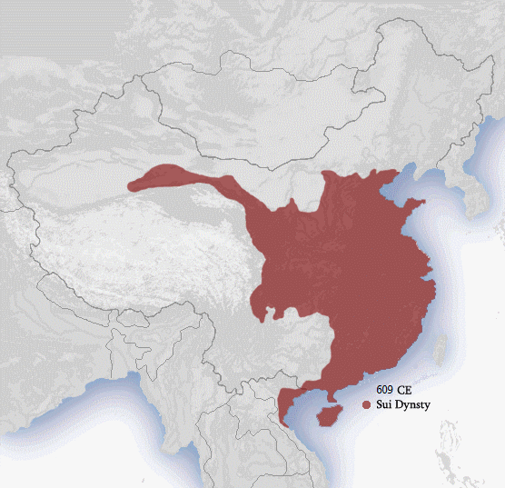

# 概述

[**隋朝**](https://zh.wikipedia.org/wiki/隋朝)（581年3月4日—619年5月23日），是[中国历史主线](中国-朝代.md#中国历史主线)之一，与[唐朝](唐朝.md)合称[隋唐](https://zh.wikipedia.org/wiki/隋唐)，国号**隋**，国君姓氏**杨**，历经3代5帝，国祚39年。

<figure>
  
  <figcaption style="font-size: 16px; color: gray">隋朝疆域图（609年）</figcaption>
</figure>

# 历史

- 581年3月4日，[北周静帝](https://zh.wikipedia.org/wiki/北周静帝)禅让帝位于外戚[杨坚](https://zh.wikipedia.org/wiki/楊堅)，杨坚登基为帝，即[隋文帝](https://zh.wikipedia.org/wiki/隋文帝)，建国号**隋**。
- 589年2月10日，[隋灭陈之战](https://zh.wikipedia.org/wiki/隋滅陳之戰)，[陈叔宝](https://zh.wikipedia.org/wiki/陳叔寶)为隋将[韩擒虎](https://zh.wikipedia.org/wiki/韓擒虎)俘虏，陈朝灭亡，隋朝统一中国。
- 618年6月18日，[隋恭帝](https://zh.wikipedia.org/wiki/杨侑)禅让[李渊](https://zh.wikipedia.org/wiki/李渊)，唐朝建立。
- 619年5月23日，[王世充](https://zh.wikipedia.org/wiki/王世充)废[恭帝杨侗](https://zh.wikipedia.org/wiki/杨侗)，自立为帝，隋朝灭亡。

# 君主世系

> [隋朝皇帝世系图](https://zh.wikipedia.org/wiki/隋朝皇帝世系图)
>
> [隋朝君主列表](https://zh.wikipedia.org/wiki/隋朝君主列表)
