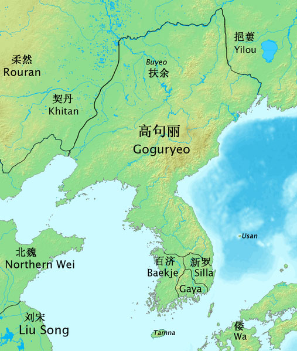
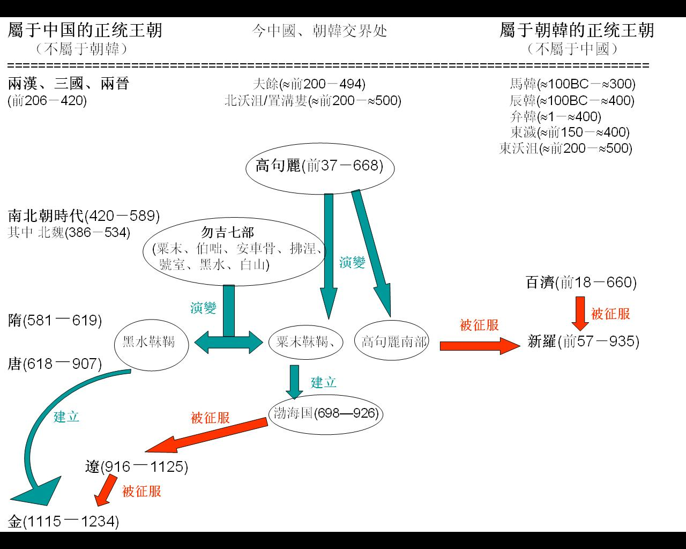

# 高句丽

## 概述

[**高句丽**](https://zh.wikipedia.org/wiki/高句丽)（前37年—668年10月22日），简称**高丽**，[朝鲜三国时期](<https://zh.wikipedia.org/wiki/三国时代_(朝鲜半岛)>)国家，横跨今日[朝鲜](<https://zh.wikipedia.org/wiki/朝鮮_(地區)>)、[中国东北](https://zh.wikipedia.org/wiki/中国东北地区)和[俄罗斯](https://zh.wikipedia.org/wiki/俄罗斯)远东部分地区。

<figure>
  
  <figcaption style="font-size: 16px; color: gray">高句丽鼎盛时期的版图</figcaption>
</figure>

## 历史

- [高句丽人](https://zh.wikipedia.org/wiki/高句丽人)祖先可追溯到[濊貊](濊貊.md)

## 争议

> [高句丽争议](https://zh.wikipedia.org/wiki/高句丽争议)

<figure>
  
    <figcaption style="font-size: 16px; color: gray">高句丽争议</figcaption>
</figure>
