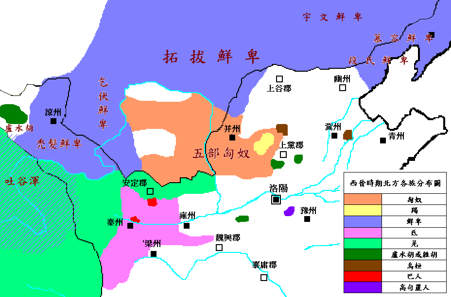

# 概述

[**鲜卑**](https://zh.wikipedia.org/wiki/鲜卑)，分支自[东胡](东胡.md)。

[鲜卑君主列表](https://zh.wikipedia.org/wiki/鲜卑#鲜卑君主列表)

<figure>
  
  <figcaption style="font-size: 16px; color: gray">西晋时期北方各族分布图</figcaption>
</figure>

# 历史

- 前206年，[东胡](东胡.md)瓦解后，其中一支即为鲜卑，臣服于匈奴。
- 91年，[北匈奴](https://zh.wikipedia.org/wiki/北匈奴)被迫西迁后，鲜卑部落入主[蒙古高原](https://zh.wikipedia.org/wiki/蒙古高原)。而匈奴余部还有大约十余万部落，皆跟随并自称鲜卑，自此鲜卑开始兴起。
- 东汉末叶（2世纪中叶），[檀石槐](https://zh.wikipedia.org/wiki/檀石槐)统一了鲜卑各部，建立了一个强大的军事部落联盟。
- 181年[檀石槐](https://zh.wikipedia.org/wiki/檀石槐)死后，联盟随即瓦解，鲜卑各部再次陷入分裂。
- 三国两晋时期，鲜卑各部独立发展，形成了许多强大的部族，如**慕容部**、**宇文部**、**段部**（东部），以及从东北向西南迁徙的**拓跋部**（北部），还有进入河西走廊的**秃发部**、**乞伏部**（西部）等。
- **西晋与五胡十六国时期**，鲜卑逐渐向中原扩张，形成多个部落政权，参与[五胡乱华](https://zh.wikipedia.org/wiki/五胡乱华)。
    - **慕容部**：[前燕](https://zh.wikipedia.org/wiki/前燕)、[后燕](https://zh.wikipedia.org/wiki/后燕)、[南燕](<https://zh.wikipedia.org/wiki/南燕_(十六國)>)、[西燕](https://zh.wikipedia.org/wiki/西燕)（西燕未列传统史学十六国）
    - **乞伏部**：[西秦](https://zh.wikipedia.org/wiki/西秦)
    - **秃发部**：[南凉](https://zh.wikipedia.org/wiki/南凉)
    - **铁弗部**：[胡夏](<https://zh.wikipedia.org/wiki/夏_(十六国)>)

- **南北朝时期**，鲜卑进入鼎盛阶段，建立起统一北方的大帝国。
    - [北魏](https://zh.wikipedia.org/wiki/北魏)最终在439年统一北方，中国进入了**南北朝对峙**时期。
    - 北魏分裂：
        - [东魏](https://zh.wikipedia.org/wiki/东魏)（高氏政权，534–550），后为[北齐](https://zh.wikipedia.org/wiki/北齐)。
        - [西魏](https://zh.wikipedia.org/wiki/西魏)（宇文部掌权，535–557），后为[北周](https://zh.wikipedia.org/wiki/北周)。

    - 北齐、北周继续承袭鲜卑势力，直到隋朝统一。

- 隋朝建立后，采取了一系列去鲜卑化措施。到隋末唐初，鲜卑语失传，鲜卑族作为一个民族实体的历史结束，鲜卑族融入中国其他民族当中。