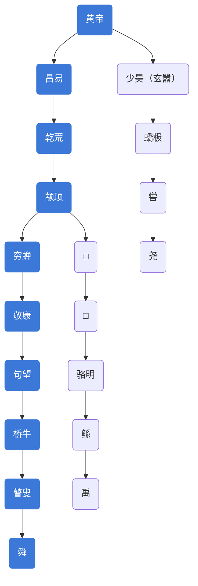

# 黄帝

[**黄帝**](https://zh.wikipedia.org/wiki/黄帝)（前2717年—前2599年），号轩辕，中国传说时代[三皇五帝](三皇五帝.md)的**五帝**之首，**炎黄二帝**中的**黄帝**。

史载黄帝的父亲[少典](https://zh.wikipedia.org/wiki/少典)为[有熊国](https://zh.wikipedia.org/wiki/有熊国)君，母为附宝，因居[轩辕之丘](https://zh.wikipedia.org/wiki/轩辕之丘)，故号**轩辕**，长居[姬水](https://zh.wikipedia.org/wiki/姬水)，为[**姬**姓](https://zh.wikipedia.org/wiki/姬姓)，国于有熊（今[河南](https://zh.wikipedia.org/wiki/河南)[新郑](https://zh.wikipedia.org/wiki/新郑)），又称**有熊氏**，**帝鸿氏**或[**归藏氏**](https://zh.wikipedia.org/wiki/归藏)相传他出生于三月初三，俗言“二月二，龙抬头；三月三，生轩辕”。

# 黄帝功绩

- 在[阪泉之战](阪泉之战.md)战胜[炎帝](炎帝.md)，炎黄融合后势力壮大，后世中国人以炎黄二帝为祖先，称自己为**炎黄子孙**。
- 在[涿鹿之战](涿鹿之战.md)战胜[蚩尤](https://zh.wikipedia.org/wiki/蚩尤)，上古大华夏部落联盟最终形成，中国至此进入了华夏时代。

# 黄帝陵墓

黄帝死后，葬在桥山，黄帝的孙子高阳（金帝颛顼）继帝位。

陕西黄陵县黄帝陵，位于陕西黄陵县城北桥山，是黄帝衣冠冢；1961年，国务院公布为全国第一批全国重点文物保护单位，编为“古墓葬第一号”，号称“天下第一陵”。黄帝陵古称“桥陵”，为中国历代帝王和著名人士祭祀黄帝的场所。

荆山黄帝陵，位于河南省灵宝市市区西20公里阳平镇。后因名其地称鼎湖“其弓曰乌号”。人们把黄帝的靴子埋在铸鼎塬上，形成了黄帝陵，并建庙祭祀。陵的西端有一高6米，周长42.5主的土堆，传说就是黄帝陵冢。陵西南有一龙须沟，传说是龙须坠落之地，此间生长一种龙须草，说是龙须所变，周围皆无。古代文人墨客纷纷前来瞻仰，李白、杜甫、白居易、刘禹锡等著名诗人都曾到此拜谒，题诗作赋，年年农历二月初九前后人们络泽不绝前往祭祀瞻拜。

# 黄帝后世

史载黄帝共有二十五个儿子，其中十四人被分封得姓。这十四人共得到十二个姓，依次为：姬、酉、祁、己、滕、葴、任、荀、僖、姞、儇、衣。而少昊、颛顼、帝喾、唐尧、以及夏朝、商朝、周朝的君主都是黄帝的子孙，这些后裔在黄帝到尧、舜、禹时期大都已经脱离黄帝母族，建立了大批的氏族方国或部落，有了独立的姓和氏；后来，周武王（姬发）从陕西东出中原建立了周朝，分封诸侯或方国，其中姬姓国53个，这些姬姓国以国为氏，于是形成了中国的大多数姓氏，中国人遂自称“黄帝子孙”或“炎黄子孙”。

黄帝死后，葬在桥山。高阳继位，高阳就是金帝颛顼。

嫘祖是黄帝的正妃，生了两个儿子，少昊（即玄嚣）和昌意，这两个人的后代都得到了天下，其血缘关系详见[五帝世系图](https://zh.wikipedia.org/wiki/五帝世系图)

